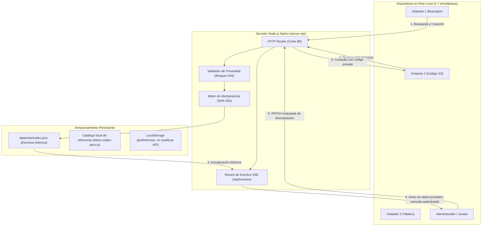

> **Publicación con la laptop apagada:** adaptador PostgreSQL opcional implementado y probado localmente; ruta elegida Render Free + Neon Free. La cuenta Neon está creada, pero **la URL pública y la conexión a esa cuenta siguen pendientes de configuración**. Pasos y límites en [DESPLEGAR-RENDER-NEON.md](DESPLEGAR-RENDER-NEON.md). Sin `DATABASE_URL` continúa el modo local JSON; las bases local y nube no se sincronizan automáticamente.

> **Ampliación:** equipo identificado, entrada multicolor y actualizaciones de participación por eventos. Protección de red y configuración del anfitrión: [RED-SEGURA-CONCURSO.md](RED-SEGURA-CONCURSO.md).

> **Código subido a GitHub (27/11/2026):** rama `arena/ccf66afb-vitara-oficial`, [pull request #1](https://github.com/danielaarcegarcia3-source/VITARA-OFICIAL/pull/1) abierto, sin fusionar `main`. Esto no es un despliegue de la aplicación. Consulta [PUBLICAR-VITARA.md](PUBLICAR-VITARA.md) antes de publicar. El panel, registro y chat necesitan Node; Pages/Hosting estático solo sirve la parte visual.

> **Actualización vigente (27/11/2026):** nuevo estudio de dispositivos y proveedores con ilustraciones IA, comparación y fichas; Canales y Fuentes interactivos; acceso guiado a administración; mapas de Perú y La Libertad con polígonos extruidos, bienvenida con logo de partículas, base blanca conmutable, participación consentida de hasta 7 usuarios y orientación integrada. Configuración privada de administración e IA en [CONFIGURACION-VITARA.md](CONFIGURACION-VITARA.md). No hay credenciales demo; los apartados históricos de cumplimiento no sustituyen las pruebas actuales de [AUDITORIA-VITARA.md](AUDITORIA-VITARA.md).

# Ecosistema Digital de Acceso a la Salud
## El "Google de la Salud Peruana" por Microrred
### Concurso Final Code Battle 2026 · Club Tech-Masters
**Grupo:** 3  
**Alineación con Objetivos de Desarrollo Sostenible (ODS):**
- 🎯 **ODS 3:** Salud y Bienestar (Meta 3.8: Cobertura universal de salud y acceso a medicamentos esenciales seguros y asequibles).
- 🏭 **ODS 9:** Industria, Innovación e Infraestructura (Monitoreo de equipos biomédicos y conectividad en salud).
- ⚖️ **ODS 10:** Reducción de las Desigualdades (Acceso equitativo para zonas rurales y periurbanas sin brecha digital).

---

## 👥 1. Identificación del Equipo y Responsabilidades (Consigna 16)

| Integrante | Rol propuesto (a confirmar por el equipo) | Responsabilidades Clave |
|:---|:---|:---|
| **Daniela Arce** | **Gestión y Requisitos** | Definición de las 168 funciones del catálogo, investigación de cifras reales (INEI, DIGEMID, RENIPRESS), cronograma y documentación técnica. |
| **Dharma Valle** | **Frontend y UI/UX** | Diseño visual responsive, buscador "Google Salud", réplica del Tablero InfoSismedLL, motor 3D interactivo Three.js y opciones de accesibilidad (sin certificación WCAG). |
| **Zoe Cabrera** | **Backend e Integración** | Servidor HTTP nativo en Node.js, comunicación en tiempo real vía Server-Sent Events (SSE), almacenamiento atómico y gestión de concurrencia. |
| **Rafael Carbajal** | **QA, Pruebas e Integración** | Batería de pruebas de concurrencia multiusuario (≥ 7 dispositivos), matriz de Verificación y Validación (V&V), seguridad y recuperación ante fallos. |

---

## 🎯 2. La Problemática en Cifras Reales

En el Perú existe una paradoja estructural: **el 91,1 % de la población declara tener algún seguro de salud (63,1 % afiliado al SIS)** (INEI · ENAHO, T1-2025). Sin embargo, solo el **38,1 % acude a un establecimiento cuando sufre un problema de salud**, debido a la incertidumbre sobre si encontrarán al médico, el equipo operativo o el medicamento.

La brecha real no es de aseguramiento; es de **certeza de acceso**.

### Regla de Oro del Ecosistema
> **Ningún dato inventado se presenta como oficial, y ningún estado ambiguo se pinta como disponible.**  
> Lo que no cuenta con evidencia humana confirmada se muestra como **"sin confirmar"** o **"dato vencido"**, garantizando honestidad técnica ante el ciudadano.

---

## 🚀 3. Funcionalidades Principales

### 3.1 Motor de Búsqueda Universal "Google Salud Perú" (F-101 a F-110)
- Búsqueda unificada en:
  - **339 Establecimientos de Salud (IPRESS)** de La Libertad con datos oficiales de SUSALUD RENIPRESS.
  - **Catálogo de Medicamentos Esenciales DIGEMID:** Comparador de medicamentos genéricos DCI vs marcas comerciales con cálculo automático de ahorro (de hasta 96.1% amparado por las Leyes 29459 y 32033).
  - **Catálogo de Equipos Biomédicos IETSI-EsSalud:** Protocolos de mantenimiento y fallas críticas auditadas por la Contraloría.
  - **Alertas Sanitarias DIGEMID:** Lotes falsificados, pesquisas y retiros voluntarios de mercado.
  - **Kits de Emergencia y Dengue:** Monitoreo especial de insumos para contención de brotes epidemiológicos en la costa norte.
- Pestañas rápidas de filtrado (Google Tabs) y chips de búsqueda asistida.

### 3.2 Solicitudes Ciudadanas Anónimas con Código G3-XXXXXX (F-003 y F-403)
- **Cero datos sensibles:** No se solicita DNI, nombre completo ni historial clínico confidencial (Cumple Ley 29733 de Protección de Datos Personales).
- El usuario recibe un código privado `G3-XXXXXX` válido por 30 días.
- **Rastreador en vivo:** Permite consultar el estado de la solicitud desde cualquier dispositivo conectado a la red local o internet.

### 3.3 Réplica Interactiva del Tablero Oficial InfoSismedLL (DIRESA La Libertad)
- Replica idéntica del tablero oficial de disponibilidad de medicamentos esenciales con corte al **31/10/2026**:
  - **339 IPRESS** monitoreadas.
  - **8 Tarjetas KPI:** %Sobrestock (34.82%), %Normostock (58.03%), %Substock (4.85%), %Desabastecido (2.30%), %Sin Rotación (6.6%), %Crítico (7.1%), %Disponibilidad Global (92.9% - Óptimo).
  - Gráfico de cascada (Waterfall) de variación mensual por red.
  - Gráfico de barras apiladas normo/sobrestock por cada una de las 12 redes de salud.
  - Gráfico de tendencia histórica de los últimos 12 meses (Nov 2025 – Oct 2026).
  - Directorio canónico filtrable por red y microrred.

### 3.4 Visualizador 3D, Plano Blueprint 2D y Navegador 3D de Medicamentos (F-611, F-1201 a F-1209)
- Modelo 3D interactivo de una posta tipo I-2 / I-3 (NTS N° 110-MINSA) renderizado con Three.js procedural:
  - Triaje y Admisión con rampa universal.
  - Consultorio de Telesalud (Teleatiendo y Línea 113).
  - Farmacia con estanterías semaforizadas y refrigerador de cadena de frío.
  - Equipos biomédicos interactivos (Ventilador volumétrico, ecógrafo portátil).
- **Navegador 3D de Medicamentos ("Pharma 3D Lab"):**
  - 5 modelos 3D procedurales: Cápsula (Amoxicilina 500mg), Tableta ranurada (Paracetamol 500mg), Vial inyectable con sello verde (Bencilpenicilina 1M UI), Frasco de infusión parenteral (Cloruro de Sodio 9‰ 1000ml) y Comprimido recubierto (Atorvastatina 20mg).
  - Pedestales reflectivos con halos de luz y raycasting interactivo.
  - Ficha HUD holográfica en pantalla con códigos SIGA/SISMED, comparativa de precios DIGEMID (-96% de ahorro en genéricos) y botón directo de solicitud G3.
- Recorrido guiado de 15 minutos en 4 paradas para la exposición oficial ante el jurado.
- **Principio de Equivalencia:** Conmutador a plano arquitectónico 2D (Blueprint) con exactamente los mismos datos del modelo 3D.

### 3.5 Canales Oficiales y Reales de Emergencia y Ayuda Médica (#canales-ayuda)
- Canales de referencia; confirmar vigencia y cobertura antes de usarlos:
  - **Línea 113 MINSA Salud Gratuita:** Enlace `tel:113` con popup interactivo del árbol oficial de opciones 1 a 6 (Dengue, Salud Mental, Afiliación SIS, Nutrición, Vacunas, Violencia intrafamiliar).
  - **Teleatiendo MINSA:** Citas virtuales gratuitas en `https://teleatiendo.minsa.gob.pe/`.
  - **Central SAMU 106:** Ambulancias de emergencia con enlace directo `tel:106`.
  - **Consulta de Afiliación SIS:** Verificación ciudadana en `https://app.sis.gob.pe/ConsultaAfiliado/`.
  - **WhatsApp Oficial MINSA:** Asistencia instantánea verificada (+51 952 842 623).
  - **Observatorio de Precios DIGEMID:** Portal de fiscalización ciudadana en `https://opm.digemid.minsa.gob.pe/`.

### 3.6 Barra de Telemetría del Sistema Operativo Sanitario & Perfiles M0
- **Barra Superior Health OS:** Reloj oficial en tiempo real de Lima (UTC-5), nivel de abastecimiento de La Libertad (92.9% Óptimo), alerta dengue costa norte, monitor de red local Wi-Fi y firewall WAF blindado.
- **Matriz de Perfiles M0 (F-001 a F-007):** Selector de rol dinámico entre `VIS` (Visitante Anónimo), `CIU` (Ciudadano con Cuenta y Alias), `AGC` (Agente Comunitario / Modo Acompañamiento F-008), `POSTA` (Personal Autorizado) y `ADM` (Administrador Regional).

### 3.7 Firewall WAF & Protección de Privacidad Activa
- **Inspección de peticiones en tiempo real:**
  - Blindaje Anti-SQLi, Anti-XSS y Path-Traversal Shield.
  - Rate Limiting de 180 req/min por IP.
  - Filtro estricto que bloquea números de DNI (Consigna 13).
  - Endpoint de auditoría en vivo `GET /api/firewall/status`.
- **Endurecimiento del servidor:**
  - Cabeceras de seguridad: CSP estricta, `nosniff`, `X-Frame-Options: DENY`, `Referrer-Policy` y `Permissions-Policy`.
  - El listado completo de solicitudes y las copias de respaldo exigen token administrativo (`Bearer`); el ciudadano solo consulta su propio código `G3-XXXXXX`.
  - Login con comparación en tiempo constante y límite de 10 intentos cada 15 minutos.
  - Validación de tipo JSON, límite de payload (1 MB), estados permitidos y saneamiento de respaldos importados.
  - Retención de 30 días con purga automática y política pública en `GET /api/privacidad`.
- **Panel de privacidad en la aplicación:** resumen de lo guardado en el navegador, exportación JSON, borrado total y depuración automática de búsquedas e interacciones con más de 30 días.

### 3.8 Panel Administrador Protegido en Tiempo Real (Consignas 5.2, 9 y 13)
- Pantalla de control separada con credenciales privadas del operador, sin acceso de demostración.
- **Server-Sent Events (SSE) nativo:** Las solicitudes enviadas por los visitantes de los otros 7 equipos se actualizan al instante sin recargar la página.
- Publicación de respuestas oficiales de farmacia que se reflejan inmediatamente en el rastreador ciudadano.
- Monitor de concurrencia en vivo.

---

## 🛠️ 4. Arquitectura del Sistema y Flujo de Información



---

## 💻 5. Guía de Instalación y Ejecución Local (Consigna 18.41)

El proyecto está diseñado para funcionar de inmediato sin configuraciones complejas ni instalaciones de bases de datos pesadas.

### Requisitos Previos
- Node.js 22 LTS o superior instalado en el equipo anfitrión.

### Paso 1: Clonar o abrir la carpeta del proyecto
```bash
git clone https://github.com/danielaarcegarcia3-source/VITARA-OFICIAL.git
cd VITARA-OFICIAL
# Elegir en GitHub la rama revisada o integrar su PR antes de clonar para la entrega.
npm ci
```

### Paso 2: Iniciar el servidor local
```bash
npm start
```
*(O de manera directa desde la raíz: `node server.mjs`)*

### Paso 3: Acceder desde los navegadores
- **Portal Público (Ciudadanos y Evaluadores):**
  - Desde la computadora anfitriona: `http://localhost:3000`
  - Desde los otros 7 equipos en la red Wi-Fi: `http://<IP_LOCAL>:3000` *(La IP exacta se imprime automáticamente en la consola al iniciar el servidor)*.
- **Panel Administrador:**
  - `http://localhost:3000/admin.html`
  - Configura `ADMIN_USUARIO` y `ADMIN_CLAVE`, o el alta inicial con `VITARA_SETUP_KEY`, antes de arrancar. Ver `CONFIGURACION-VITARA.md` y usar Node 22.

---

## 🧪 6. Pruebas vigentes y cumplimiento

```sh
npm ci
npm run test:services
npm run test:security
npm run test:assets
npm run build
npx playwright install chromium
npm test
npm audit --audit-level=low
```

- `test:security` ejecuta el servidor real en puerto y carpeta temporales: siete clientes SSE concurrentes, perfiles y solicitudes, privacidad, permisos, borrado, respaldo/recuperación y reinicio. No contamina el portal.
- `npm test` ejecuta Playwright; no es la herramienta histórica ni una prueba de siete dispositivos físicos.
- Resultados y pendientes: [V_AND_V_MATRIZ.md](V_AND_V_MATRIZ.md), [CONSIGNA-CUMPLIMIENTO.md](CONSIGNA-CUMPLIMIENTO.md), [SEGURIDAD.md](SEGURIDAD.md).
- Pendientes para cumplimiento completo: confirmar la distribución de roles, permisos de medios aportados, ensayo físico LAN/WAN y enlace público gratuito con el servidor completo.

## 🔄 7. Procedimiento de Recuperación ante Interrupciones (Consignas 10.3 y 18.46)

1. **Modo local de las funciones principales:**
   Si se corta el suministro de Internet en el local del concurso, la aplicación continúa permitiendo sus funciones principales con el Node local activo. Catálogos y modelos se sirven localmente; los enlaces oficiales y la IA externa no funcionan sin WAN.
2. **Escritura Atómica en Disco:**
   Cada nueva solicitud se escribe primero en un archivo temporal (`data/solicitudes.json.tmp.<timestamp>`) y luego se renombra atómicamente, reduciendo el riesgo de escritura parcial. No garantiza supervivencia ante fallo de disco o corte eléctrico; mantener respaldos y ensayar recuperación.
3. **Copia de Respaldo y Restauración en 1 Clic:**
   Desde el panel de administración, el evaluador o administrador puede presionar **"Exportar Copia de Respaldo JSON"** para descargar el archivo de datos actual. En caso de desastre, basta con subir dicho archivo en **"Restaurar Respaldo JSON"** para recuperar las solicitudes válidas del respaldo. No incluye perfiles ni configuración administrativa; estos requieren una copia privada del directorio con el servidor detenido. Ver CONSIGNA-CUMPLIMIENTO.md.

---

## 💰 8. Declaración de Cumplimiento de Costo Cero (Consigna 11)

| Recurso | Servicio / Tecnología | Costo Mensual | Justificación |
|:---|:---|:---:|:---|
| **Servidor y API** | Node.js Nativo (`node:http`, `node:fs`) | **$0.00** | Cero pago de licencias o servidores dedicados. |
| **Persistencia** | Almacenamiento JSON atómico local | **$0.00** | Sin base de datos de pago; Firestore no se usa y sus reglas se cierran por defecto. |
| **Mapas Cartográficos** | GeoJSON MPL 2.0, Three.js y alternativa SVG | **$0.00** | Evita las cuotas de pago de Mapbox y Google Maps. |
| **Motor Gráfico 3D** | Three.js (r158) y Draco locales | **$0.00** | Biblioteca de código abierto sin licencias comerciales. |
| **Dominio y Red** | Red local Wi-Fi del concurso | **$0.00** | Sin compra de dominio. Acceso público completo pendiente de configurar y validar. |
| **TOTAL** | — | **$0.00** | **Sin pagos activados; verificar el acceso público elegido** |

---

## ⏱️ 9. Guion para la Exposición Oficial de 15 Minutos (Consigna 19)

- **Minuto 0:00 – 2:00 (Integrante 1):**  
  Presentación del problema real: 91,1 % asegurados vs 38,1 % atención efectiva. Justificación de los ODS 3, 9 y 10.
- **Minuto 2:00 – 4:00 (Integrante 2 y 3):**  
  Arquitectura del ecosistema: Presentación de la interfaz pública, conexión con el backend Node.js y enfoque de honestidad de datos (seis estados, sin semáforos engañosos).
- **Minuto 4:00 – 11:00 (Los 4 Integrantes):**  
  **Demostración funcional en vivo:**
  - Los otros 7 equipos visitantes ingresan desde sus teléfonos/laptops a `http://<IP_LOCAL>:3000`.
  - Búsqueda de medicamentos genéricos y ahorro del 96%.
  - Envío de solicitudes ciudadanas anónimas con código privado `G3-XXXXXX`.
  - Recorrido 3D interactivo guiado por las 4 áreas de la posta.
  - Exploración del Tablero Regional InfoSismedLL con 339 IPRESS.
- **Minuto 11:00 – 13:00 (Integrante 3 y 4):**  
  Exhibición del Panel Administrador recibiendo las solicitudes en tiempo real vía SSE, respuesta médica y demostración de concurrencia y backup.
- **Minuto 13:00 – 15:00 (Integrante 1):**  
  Impacto social en salud pública, limitaciones conocidas y conclusiones.
